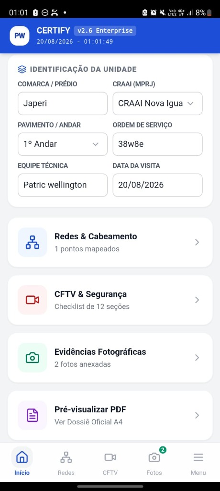
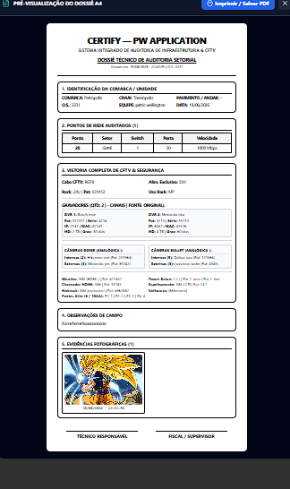
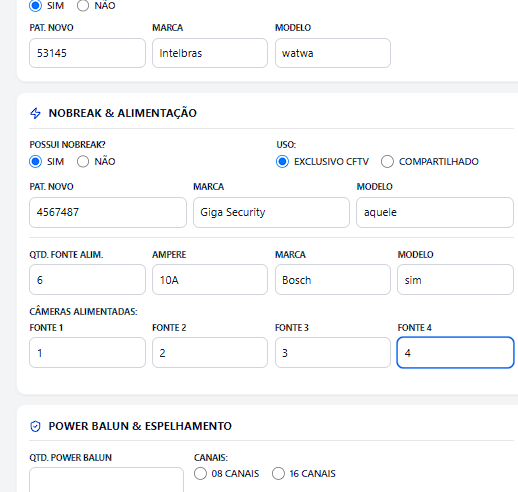
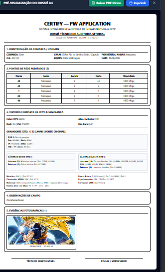

  <strong>English</strong> | <a href="https://github.com/PW-SYSTEM/.github/blob/main/profile/README.pt-BR.md">Português</a>

  
    
  
    
  

    
    
    
    
  

---

### 🏢 About PW-SYSTEM

PW-SYSTEM acts as the technical engineering and governance umbrella for mission-critical enterprise systems, field service automation, and defensive operations infrastructures. 

Our solutions are deployed across public concessions, telecom networks, and large-scale industrial operations where system failures, security leaks, or operational downtime are unacceptable.

---

### 🛡️ Core Enterprise Systems

* **PW OpsDesk:** Real-time event-driven central dispatch and ITSM monitoring desk engineered with granular Role-Based Access Control (RBAC), biometric challenge-response, and offline-first queue synchronization.
* **PW Certify Enterprise:** Multi-platform mobile inspection client (Capacitor/Tauri) with cryptographic hardware fingerprinting, GPS polygon locking, and automated forensic PDF report generation.
* **Bastion Audit Enterprise:** Autonomous security compliance agent, asset inventory scanner, and tamper-evident SHA-256 chained audit ledger for sensitive network perimeters.
* **Resolve-IT:** Operational field ticketing bridge with bidirectional enterprise ITSM API synchronization (HaloITSM standard).

---

### 📸 Production Operational Showcase

Field captures from enterprise deployments demonstrating dispatcher controls, mobile inspection workflows, and cryptographic evidence sealing:

<table width="100%">
  <tr>
    <td width="50%" align="center" valign="top">
      
      
<strong>Operational Dispatch Hub:</strong> Real-time ticket routing, live supervisor radar, and queue governance.

    </td>
    <td width="50%" align="center" valign="top">
      
      
<strong>Network Infrastructure Mapping:</strong> Switch port auditing, topology discovery, and telecom rack verification.

    </td>
  </tr>
  <tr>
    <td width="50%" align="center" valign="top">
      
      
<strong>CCTV Camera Compliance Checklist:</strong> Point-to-point stream validation, optic alignment, and physical hardening.

    </td>
    <td width="50%" align="center" valign="top">
      
      
<strong>Forensic PDF Audit Dossier:</strong> Digitally signed, tamper-evident inspection reports generated in real time.

    </td>
  </tr>
</table>

---

### 🔍 Architectural Public Showcases & Open Specifications

For architectural designs, public system specifications, and decoupled technical engines, explore our open showcases:

* 📡 **[PW OpsDesk Architecture Showcase](https://github.com/welzim19-star/pw-opsdesk-showcase):** High-level event-driven dispatch and SLA specifications.
* 🛡️ **[Bastion-Core Engine](https://github.com/welzim19-star/bastion-core):** Sanitized, open-source asynchronous network audit daemon and SHA-256 cryptographic ledger.
* ⚡ **[Systems Engineer Profile (@welzim19-star)](https://github.com/welzim19-star):** Technical portfolio and low-level engineering implementations.

---

🇧🇷 <strong>Visualizar Apresentação Corporativa em Português (Clique para Expandir)</strong>

 

### 🏢 Sobre a PW-SYSTEM

A PW-SYSTEM atua como a organização técnica de engenharia e governança para sistemas corporativos de missão crítica, automação de operações de campo e infraestruturas defensivas.

Nossas soluções atendem concessionárias de serviços públicos, redes de telecomunicações e operações industriais de larga escala, onde falhas de sistema, vazamento de informações ou interrupções operacionais são inaceitáveis.

### 🛡️ Ecossistema de Sistemas Corporativos

* **PW OpsDesk:** Central operacional e mesa de despacho ITSM em tempo real, orientada a eventos, com governança RBAC granular, desafio-resposta biométrico e sincronização de filas offline-first.
* **PW Certify Enterprise:** Cliente móvel multiplataforma de inspeção técnica (Capacitor/Tauri) com impressão digital criptográfica de hardware, bloqueio por polígono GPS e emissão automatizada de laudos periciais em PDF.
* **Bastion Audit Enterprise:** Agente autônomo de conformidade de segurança, inventário de ativos em tempo real e trilha imutável de auditoria com encadeamento criptográfico SHA-256 para perímetros de rede sensíveis.
* **Resolve-IT:** Ponte operacional de atendimento e resolução de chamados de campo com sincronização bidirecional com APIs ITSM corporativas (padrão HaloITSM).

### 🔍 Especificações Públicas & Vitrines Técnicas Desacopladas

* 📡 **[Vitrine Arquitetural PW OpsDesk](https://github.com/welzim19-star/pw-opsdesk-showcase):** Especificação de despacho orientado a eventos e SLAs corporativos.
* 🛡️ **[Motor Bastion-Core](https://github.com/welzim19-star/bastion-core):** Daemon assíncrono de auditoria de rede e ledger criptográfico SHA-256 sanitizado (código aberto).
* ⚡ **[Perfil de Engenharia de Software (@welzim19-star)](https://github.com/welzim19-star):** Portfólio técnico e implementações de baixo nível.

---

### 🔒 Enterprise Governance & Confidentiality Notice

*Proprietary algorithms, production source code, commercial deployment manifests, and client integration environments are private commercial assets managed under strict Non-Disclosure Agreements (NDA) and LGPD/SOC 2 compliance frameworks.*

  © 2026 PW-SYSTEM. All rights reserved.

