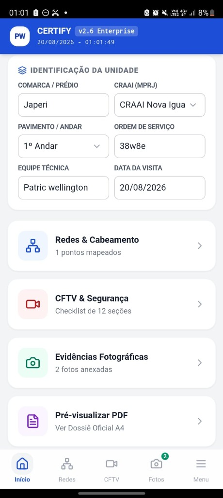
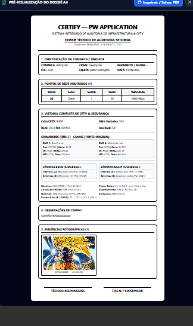
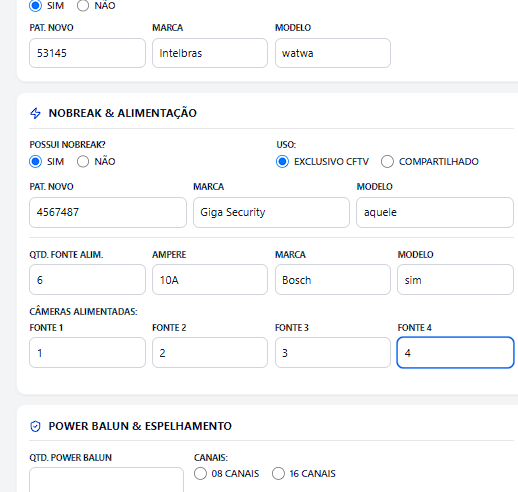
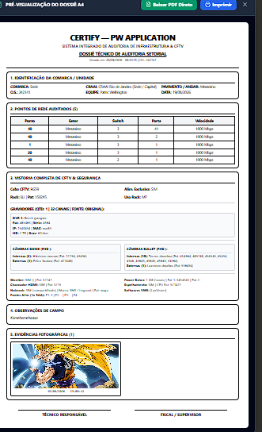

  <a href="README.md">English</a> | <strong>Português</strong>

  
    
  
    
  

    
    
    
    
  

---

### 🏢 Sobre a PW-SYSTEM

A PW-SYSTEM atua como a organização técnica de engenharia e governança para sistemas corporativos de missão crítica, automação de operações de campo e infraestruturas defensivas.

Nossas soluções atendem concessionárias de serviços públicos, redes de telecomunicações e operações industriais de larga escala, onde falhas de sistema, vazamento de informações ou interrupções operacionais são inaceitáveis.

---

### 🛡️ Ecossistema de Sistemas Corporativos

* **PW OpsDesk:** Central operacional e mesa de despacho ITSM em tempo real, orientada a eventos, com governança RBAC granular, desafio-resposta biométrico e sincronização de filas offline-first.
* **PW Certify Enterprise:** Cliente móvel multiplataforma de inspeção técnica (Capacitor/Tauri) com impressão digital criptográfica de hardware, bloqueio por polígono GPS e emissão automatizada de laudos periciais em PDF.
* **Bastion Audit Enterprise:** Agente autônomo de conformidade de segurança, inventário de ativos em tempo real e trilha imutável de auditoria com encadeamento criptográfico SHA-256 para perímetros de rede sensíveis.
* **Resolve-IT:** Ponte operacional de atendimento e resolução de chamados de campo com sincronização bidirecional com APIs ITSM corporativas (padrão HaloITSM).

---

### 📸 Vitrine de Operações em Produção

Registros de campo em ambiente corporativo demonstrando os fluxos de despacho, auditoria técnica e selamento criptográfico:

<table width="100%">
  <tr>
    <td width="50%" align="center" valign="top">
      
      
<strong>Central de Despacho:</strong> Roteamento de ordens de serviço em tempo real, radar de equipes e gestão de filas.

    </td>
    <td width="50%" align="center" valign="top">
      
      
<strong>Mapeamento de Redes:</strong> Auditoria de portas de switch, topologia e validação de racks de telecom.

    </td>
  </tr>
  <tr>
    <td width="50%" align="center" valign="top">
      
      
<strong>Checklist de CFTV:</strong> Validação de fluxo de vídeo ponto a ponto, foco ótico e integridade física.

    </td>
    <td width="50%" align="center" valign="top">
      
      
<strong>Dossiê Pericial em PDF:</strong> Laudos técnicos gerados assincronamente com assinatura digital e carimbo de tempo.

    </td>
  </tr>
</table>

---

### 🔍 Especificações Públicas & Vitrines Técnicas Desacopladas

Para projetos de arquitetura, especificações abertas e motores de software desacoplados:

* 📡 **[Vitrine Arquitetural PW OpsDesk](https://github.com/welzim19-star/pw-opsdesk-showcase):** Especificação de despacho orientado a eventos e SLAs corporativos.
* 🛡️ **[Motor Bastion-Core](https://github.com/welzim19-star/bastion-core):** Daemon assíncrono de auditoria de rede e ledger criptográfico SHA-256 sanitizado (código aberto).
* ⚡ **[Perfil de Engenharia de Software (@welzim19-star)](https://github.com/welzim19-star):** Portfólio técnico e implementações de baixo nível.

---

### 🔒 Governança Corporativa & Aviso de Confidencialidade

*Algoritmos proprietários, código-fonte de produção, manifestos de implantação comercial e ambientes de integração de clientes são ativos comerciais privados regidos por acordos estritos de confidencialidade (NDA) e diretrizes de conformidade LGPD e SOC 2.*

  © 2026 PW-SYSTEM. Todos os direitos reservados.

